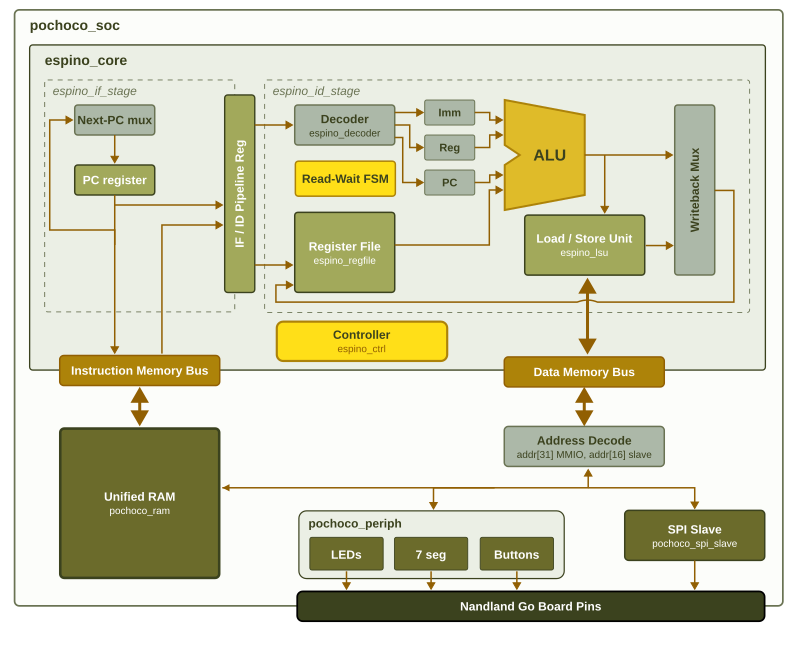

# Proyecto 4 — Pochoco Trader (co-diseño HW/SW sobre Espino Core)

Agente de inversión que corre en el Espino Core: recibe el precio por SPI, decide comprar / vender / mantener y escribe `DECISION`.
**Versión final (V2):** cruce de EMA rápida (α = 2⁻⁶) y lenta (α = 2⁻⁸), largo/efectivo con histéresis, sobre un ALU con shifter parcial.

## Contenido

| Ruta | Qué es |
|---|---|
| `sw/trade.s` | **Programa final (V2)**: EMA 64/256 con shifter parcial |
| `sw/trade_sw.s` | V0: solo software, SMA 128/512 con anillo de 512 bytes (sin cambios de RTL) |
| `sw/trade_hw.s` | V1: indicador SMA en el periférico `rtl/pochoco_sma.v` |
| `sw/assembler.py` | Assembler del grupo (agrega `lbu`, `sb`, `slli`, `srli`, `srai`) |
| `rtl/trade_top.v` | Top de la placa, versión final (`trade_sw_top.v`, `trade_sw_lite_top.v`, `trade_hw_top.v` para las otras variantes) |
| `rtl/pochoco_sma.v` | Acelerador de la variante V1 |
| `rtl/espino_core/espino_alu.v` | Parámetro `UseShifter`: SLL por 2, 6 y 8; SRL por 6 y 8 (el resto sigue como ADD) |
| `tb/tb_proyecto_4.sv` | Testbench oficial (emula la maestra) |
| `tb/tb_metrics.sv` | Mismo escenario + métricas por tick (ciclos, IC, CPI) y perfil por instrucción |
| `tb/tb_sma.sv` | Testbench del acelerador `pochoco_sma` |
| `ref/` | Referencias en Python: `market.py` (contabilidad oficial), `trader_ref.py` (V0/V1), `trader_ref_ema.py` (V2 final), `compare.py`, `hw_report.sh` |
| `informe/` | Fuente LaTeX (Overleaf), figuras y datos del informe |
| `docs/resultados_hw.md` | Tabla de variantes generada por `ref/hw_report.sh` |
| `tb/practica.csv` | Serie de práctica (Meta, 20 000 ticks, precios 100–255) |

## Cómo usar (desde la raíz del repositorio)

Herramientas probadas: Yosys 0.68+130, nextpnr-ice40 0.11.1 (`--hx1k --package vq100`), Icarus Verilog 14.0 (`-g2012`), Python 3.9.6 (numpy 2.0.2, matplotlib 3.9.4 solo para `informe/analisis.py`), oss-cad-suite en el `PATH`.

```bash
make trade            # ensambla trade.s, trade_sw.s y trade_hw.s con sw/assembler.py (no se usa un assembler externo)
make p4-test          # testbench oficial con la versión final (4 chequeos)
make test             # pruebas unitarias del assembler
make all              # sintetiza trade_top, place & route a 25 MHz, genera el bitstream y programa la Go Board
```

Para sintetizar otra variante: `make all TOP=trade_hw_top` (necesita `sw/trade_hw.hex`, se genera con `make trade`).

Testbenches adicionales:

```bash
iverilog -g2012 -s tb_sma -o /tmp/tb_sma rtl/pochoco_sma.v tb/tb_sma.sv && vvp -n /tmp/tb_sma     # acelerador V1
iverilog -g2012 -s tb_metrics -o /tmp/tb_m $(yosys-config --datdir)/ice40/cells_sim.v rtl/*.v rtl/espino_core/*.v tb/tb_metrics.sv && vvp -n /tmp/tb_m
#   variantes: -DSW (V0), -DSMA (V1); sin define = versión final. -DNT=20000 -DPER=20000 corre la serie completa más rápido.
bash ref/hw_report.sh   # tabla de LUTs, celdas lógicas, BRAM, Fmax, ciclos, IC y CPI por variante
```

### Versión de referencia y equivalencia

`ref/trader_ref_ema.py` es la referencia bit-exacta de `sw/trade.s` (`ref/trader_ref.py` lo es de V0 y V1). Para comprobar que el assembly toma **exactamente** las mismas decisiones en toda la serie:

```bash
make p4-test                                           # escribe decisiones.csv (2000 ticks)
python3 ref/compare.py tb/practica.csv decisiones.csv ema   # "diferencias: 0"
python3 ref/trader_ref_ema.py tb/practica.csv          # patrimonio, órdenes y pérdida máxima de la referencia
```

(Para V0/V1 omitir el tercer argumento `ema`.) Con `-DNT=20000` el chequeo cubre los 20 000 ticks.

## Resumen de resultados (serie de práctica de Meta, 20 000 ticks)

| Estrategia | Patrimonio final | Órdenes | Pérdida máx. |
|---|---|---|---|
| No operar | 10 000 | 0 | 0 |
| Comprar y mantener | 9 695 | 1 | 9 300 |
| V0 SMA 128/512 | 9 962 | 44 | 5 163 |
| **V2 EMA 64/256 (final)** | **10 532** | 26 | 4 502 |

| Variante | LUTs | Celdas lógicas (de 1280) | Fmax | Ciclos prom / máx | IC prom | CPI |
|---|---|---|---|---|---|---|
| V0 software | 973 | 1152 | 46,8 MHz | 82,4 / 100 | 36,6 | 2,25 |
| V1 acelerador SMA | 994 | 1195 | 42,0 MHz | 51,8 / 564 (1.er tick) | 21,1 | 2,45 |
| **V2 shifter + EMA** | 1040 | 1205 | 45,3 MHz | 50,6 / 63 | 22,2 | 2,28 |

Presupuesto de la ronda 3: 2262 ciclos. La PLL no es una opción en esta placa (el iCE40 HX1K no la tiene).

## Notas de diseño

- La maestra recorta las compras a lo que alcanza la caja y las ventas a lo que se tiene, y una orden sin efecto no paga comisión. Por eso el programa envía ráfagas de 6 órdenes de 63 acciones al cambiar de estado y no necesita llevar la contabilidad.
- Las variantes V1 y V2 usan `LitePeriph=1` (sin LEDs, displays ni contador de ciclos) para caber en 1280 celdas lógicas.
- Todo el hardware agregado tiene testbench: `tb_sma.sv` para el acelerador y `tb_metrics.sv` / `tb_proyecto_4.sv` (con comparación contra la referencia) para el ALU con shifter.
- Datos sintéticos para validar robustez: `ref/gen_series.py` (requiere precios diarios descargados a `/tmp/p4data/*.json`; no se usan dentro del diseño).

---

# Pochoco SoC & Espino Core

> Meet Pochoco SoC and Espino Core. Inspired by the native flora of the Pochoco trails, it is an entry-level, highly efficient architecture designed to flourish in resource-constrained environments.



Welcome to the repository! This project contains the RTL for a custom 32-bit processor and its surrounding System-on-Chip (SoC) designed for FPGA deployment. The design is kept straightforward to help explore and understand computer architecture fundamentals.

This is meant to be forked, not just cloned. You'll be poking around the RTL, so make it your own, we won't judge (we might even be a little proud).

## Proyecto 2: juego de reflejos

Este fork agrega un juego de reflejos para la Go Board. Al arrancar, los
displays muestran `88` para indicar que el programa esta listo; la partida se
inicia presionando y soltando cualquier boton. Cada ronda enciende los cuatro LEDs
durante tres segundos, selecciona un LED objetivo, mide la respuesta en decimas
de segundo y conserva diez tiempos correctos. Un boton incorrecto muestra `EE`
y reinicia solamente la ronda actual. El tiempo del decimo acierto permanece
visible hasta presionar y soltar cualquier boton; entonces se muestra el
promedio.

El flujo del software es:

```text
sw/game.s -> sw/assembler.py -> sw/game.hex -> memoria de Pochoco -> Espino Core
```

`game.hex` se genera con el assembler desarrollado para el proyecto; no depende
de un assembler RISC-V externo.

Desde la raiz del repositorio:

```bash
make game       # regenera sw/game.hex desde sw/game.s
make test       # ejecuta las pruebas del assembler
make all        # sintetiza, genera el bitstream y programa la Go Board
```

`make all` requiere la Go Board conectada. El top-level sintetizado es
`rtl/game_top.v`, que selecciona `sw/game.hex` como imagen de memoria.

## Repository Structure

The hardware is written in Verilog and divided into these main categories:

* **The Espino Core**: The central processing unit. It includes all standard pipeline stages like instruction fetch, instruction decode, an ALU for execution, a register file, a load/store unit for memory operations, and a pipeline controller. It implements [RV32E](https://docs.riscv.org/reference/isa/v20260120/unpriv/rv32.html) with a catch you might want to check out the code for.
* **The Pochoco SoC**: The top-level system wrapper. It connects the CPU core to a unified instruction/data RAM, physical board peripherals (like LEDs, switches, and displays), and an external SPI slave interface.
* **Build Files**: Constraints to map the design to the physical FPGA pins, and automation scripts for synthesis, routing, and flashing using an open-source toolchain.

## Memory Map

The SoC routes memory and data requests using a hardcoded address decoding scheme based on the highest bits of the 32-bit address.

* **`0x0000_0000` - Unified RAM**: The shared memory space for both instructions and data.
* **`0x8000_0000` - Board Peripherals**: Memory-mapped I/O for the physical board.
  * `Offset 0x00`: 7-Segment Displays
  * `Offset 0x04`: LEDs
  * `Offset 0x08`: Button Inputs
  * `Offset 0x0C`: Free-running 32-bit cycle counter
* **`0x8001_0000` - SPI Slave**: Custom SPI interface routing.
  * `Offset 0x00`: SPI Status (Chip Select state, New Data flag)
  * `Offset 0x04`: Received "Price" byte (from external master)
  * `Offset 0x08`: "Decision" byte (written by CPU to transmit)

Dive into the source code to see exactly how these components and connections are built under the hood!

## How to Build

To synthesize and build the project, you will need the open-source FPGA toolchain.

1. Install the tools by following the instructions at the [oss-cad-suite-build repository](https://github.com/yosyshq/oss-cad-suite-build).
2. Once installed, ~~blindly copy-paste~~ (we strongly encourage reading the Makefile first to make sure we aren't deleting your home directory) the following command in the project root to generate and program the final bitstream:

```bash
make all
```

## Software

The `sw/` folder holds the RV32E assembly example programs that run on the Espino Core (`blink.s`, `7seg.s`, `buttons_leds.s`), plus a `Makefile` to assemble them into the `.hex` files the RTL loads at boot via `$readmemh`.

You'll need a RISC-V toolchain on your `PATH` (`riscv64-unknown-elf-{as,ld,objcopy}` on Debian/Ubuntu/WSL via `sudo apt install gcc-riscv64-unknown-elf`, or `brew install riscv64-unknown-elf-gcc` on macOS). If your toolchain uses a different prefix, override it on the command line rather than editing the Makefile:

```bash
cd sw
make blink                        # assembles blink.s -> blink.hex
make PREFIX=riscv64-elf- blink    # if your toolchain uses a different prefix
```

Drop a new `<name>.s` file in `sw/` and `make <name>` picks it up automatically, no `Makefile` changes needed. The Project 2 game is selected by `rtl/game_top.v`.

**CATCH:** The core implements [RV32E](https://docs.riscv.org/reference/isa/v20260120/unpriv/rv32.html), with one thing worth knowing: shift instructions (`SLL`/`SRL`/`SRA`/`SLLI`/`SRLI`/`SRAI`) are decoded correctly but disabled in the ALU to save LUTs on the target FPGA, so they currently execute as `ADD` instead. Avoid shifts in your assembly, or design your own shifter...
